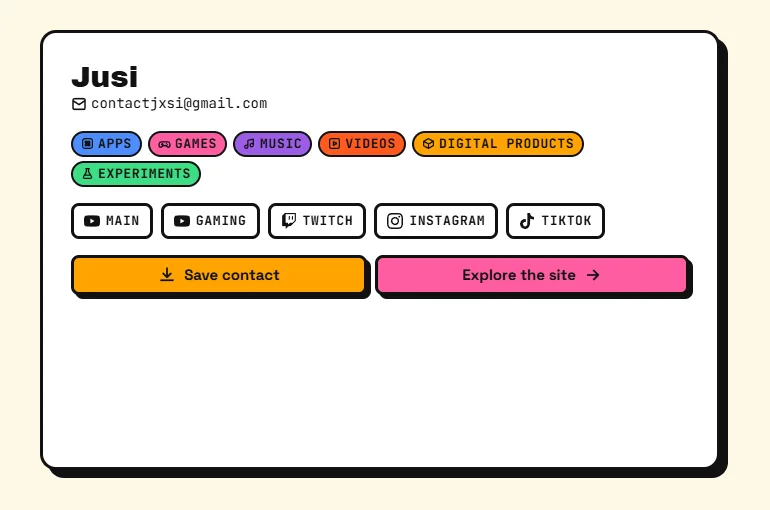

My printed business card only has a QR code on it. The website is the real
card. So I made the start page of jxsi.ch exactly that: one card, nothing
else.

## What's new

- **A creative license.** The front is a little parody of a famous fake ID,
  turned into a "Switzerland · Creative License": photo, a red number, date
  of birth, "EXP: NEVER" and my real signature. Instead of height and eye
  colour it counts my projects per category (apps, games, music, videos), live
  from the site's content.
- **The back** shows what I make, my e-mail, every social account as a small
  labelled pill and two buttons: *Save contact* (a real vCard) and *Explore
  the site*.
- **Flip it.** Click or tap and the card turns over in 3D. With reduced
  motion it fades instead.
- **An easter egg** for people who flip it too often.

## What was hard

The signature. I wrote it on paper, took a photo and wrote a small script that
cuts out the ink and throws away the paper. Getting the threshold right so
the thin strokes survive took more tries than I want to admit.

Making the card fit on a phone was the other one. The back has a lot of
pills, and on a 375 px screen the card grew into a tall sheet of paper. A
container query now makes everything more compact on small cards: labels only
where two pills share a network, smaller chips, buttons side by side. On an
iPhone the card went from 406 px to 259 px high and looks like a card again.

## Bugs fixed

- After moving between pages without a reload, the card sometimes showed
  **both sides at once**. The class that tells the card "JavaScript is here"
  got lost during the page transition. It is kept now.
- The flip buttons ended up underneath the easter egg overlay and could not
  be clicked.
- Icon-only social links could not tell my two YouTube channels apart. Every
  pill has a short label now (Main, Gaming, …).
