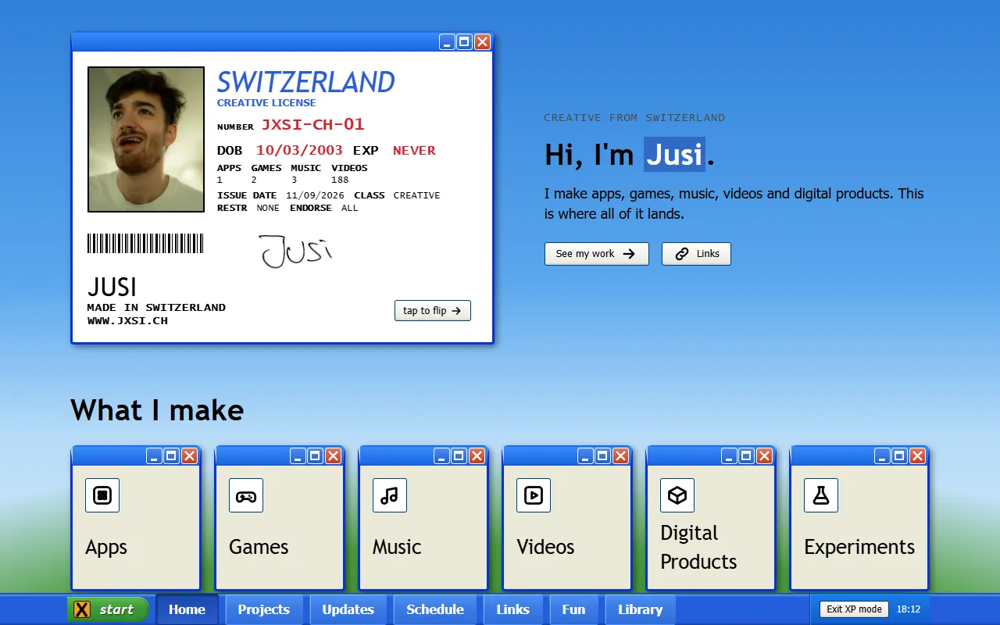

The site has a playground now: **[fun.jxsi.ch](https://fun.jxsi.ch)**, a
place for small browser games. No accounts, no downloads. The first game is
the simplest one I could think of.

## The Button

One red button and one number: every click by everyone, ever, added up. It
never resets. Next to it you see your own clicks, how many people have
clicked, the clicks today, the longest streak (with a name, if the person
gave one), your rank and a top 5.

All of that lives in a single Cloudflare Durable Object with its own small
SQLite database. Every click from every browser lands in the same place, so
the number is the same for everybody.

## Also new

- **My logo.** The orange JXSI square replaced the star in the navigation,
  became the favicon (redrawn as an SVG) and the app icon on phones. The
  yellow of the whole site is now exactly the logo colour.
- **Fun in the menu** and a teaser card for The Button on the hub.
- **A secret.** Click the logo three times quickly and see what happens.

## What was hard

One build, two websites. The fun pages are built together with the main
site, and the worker decides by host name which files to serve. The trick is
that links between games are relative, so they work on both hosts, and links
back to the main site are absolute.

## Bugs fixed

- In my display font the dot of a lowercase **i** melted into the stem at
  18 px in Chrome. "Music" read like "MusIc". Every label in that font is now
  at least 20 px, and the rule is written down so it does not come back.
- The orange of *Videos* looked almost like the new yellow. It is redder now.
