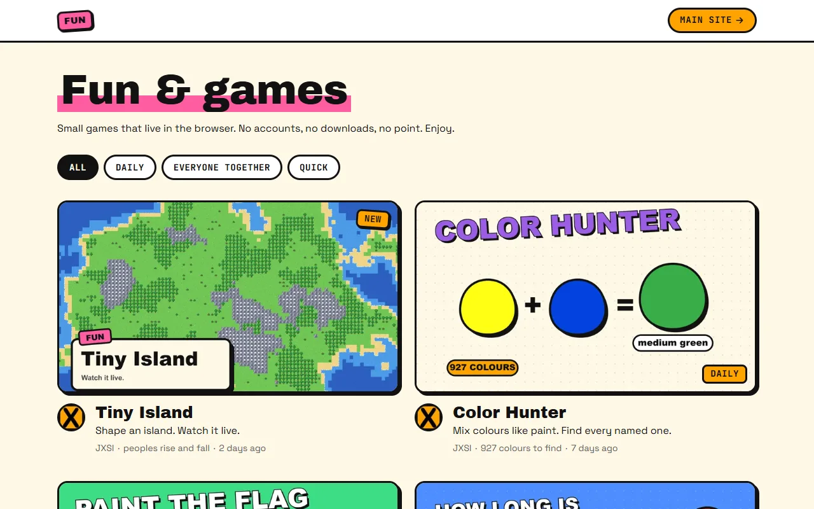

My favourite one so far: **[Color Hunter](https://fun.jxsi.ch/colors)**. You
start with five colours (red, yellow, blue, white and black), drop them onto
a big board and let one drop fall onto another. They mix, and maybe you just
found *salmon*, *teal* or *baby poop green*. There are 927 named colours to
find.

## What's new

- **Mixing like real paint.** Blue and yellow make green here, not grey.
  The mixing uses a model of how pigments absorb light (Kubelka–Munk, via
  the open-source library spectral.js).
- **A collection book** with colour families, rarities from Common to
  Legendary, empty "???" tiles and hints.
- **A daily colour** that is the same for everyone: find it in as few mixes
  as you can and share your result as an emoji row.
- Milestones unlock more palette slots, mixing ratios, magenta, cyan and a
  colour thermometer.
- Sounds made in the browser, export and import of your progress, fullscreen,
  and a short link: **jxsi.ch/colors**.

## Also this week

The games page got a new look: a feed like on a video site, with a big
thumbnail for every game, little badges (Daily, Live, New) and the live click
count of The Button.

The *Videos* number on my business card now counts itself: the worker reads
the video count of all my YouTube channels every 30 minutes. The "latest
video" on the hub refreshes on its own too, without a new build.

## What was hard

**Making sure every colour can be found.** The names come from a huge public
colour survey. Some of them are rude, so those got filtered out, and seven
neon colours can never come out of mixing paint at all, so they were dropped.
For the rest a build script works out the fewest mixing steps you need for
each colour. That number decides its rarity and how close you must get. If a
colour cannot be reached, its tolerance gets a little looser, until every
single one of the 927 is possible.

## Bugs fixed

- The "latest video" fallback file was never updated, because the script
  wrote it to the wrong path.
- *(a few days later)* The side panel had a scroll box inside a scrolling
  column. Now the whole right side scrolls as one, on desktop and on phones.
