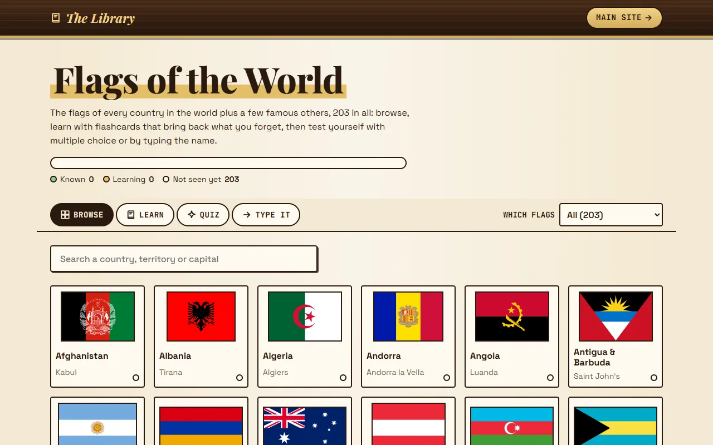
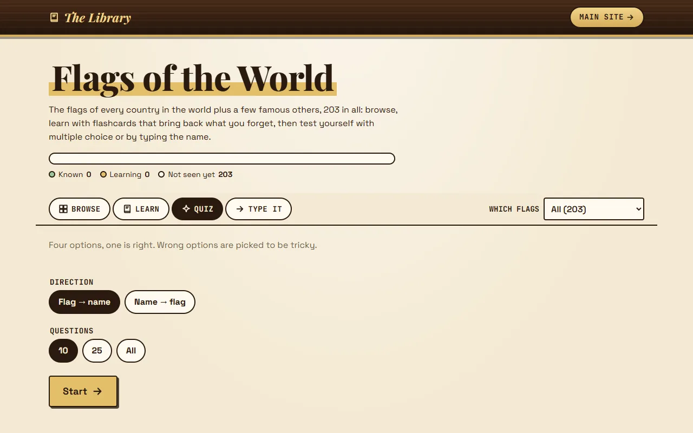

Games are fun, but I also wanted a place to actually learn something. So
there is a new part of the site: **[library.jxsi.ch](https://library.jxsi.ch)**,
a quiet reading room with a walnut bookcase. Every real book on the shelf is a
topic you can learn and test yourself on.

## The first book: Flags of the World

- **Browse:** every flag with its capital, continent and status, plus flags
  that look the same or similar.
- **Learn:** flashcards with Leitner boxes. Flags you know come back in a few
  weeks, flags you miss come back three cards later.
- **Quiz:** multiple choice in both directions, flag to name or name to flag.
  The wrong answers are chosen to be tricky: look-alikes, the same continent,
  similar colours.
- **Type it:** type the name. A typo or two is fine on long names, and
  other names count too.

## What was hard

**The look.** The library is meant to feel old, the opposite of the bright
main site. It uses its own serif font, parchment instead of white, brown
instead of black and softer shadows. The bookcase, the leather spines, the
gold lines and the brass label holders are all just CSS. No images.

**The menu.** With the library the main navigation has seven entries. On
phones it stays a bar at the bottom up to 959 px wide and only moves into
the header on bigger screens. The labels get a bit smaller on narrow
phones so all seven still fit.

## Changed after launch

The first version had **254 flags**: every country, every territory and the
parts of the UK. It turned out most territories fly a copy of their parent's
flag, or something almost identical, and almost nobody knows them. They were
noise. Now the book has **203**: the 197 countries plus England, Scotland,
Wales, Greenland, Hong Kong and Puerto Rico.
