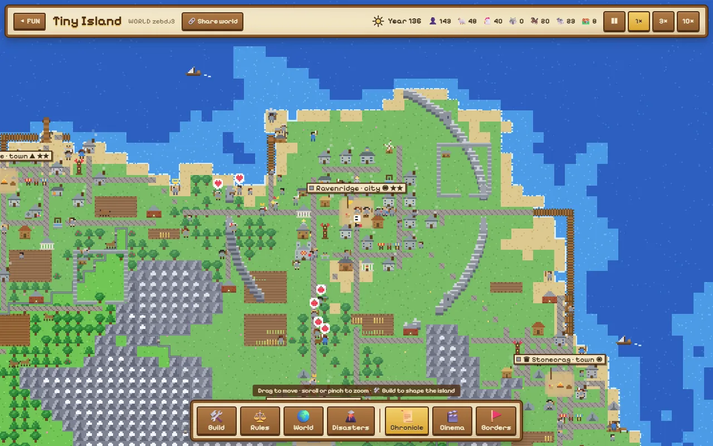

The biggest thing I have made for the site so far:
**[Tiny Island](https://fun.jxsi.ch/tiny-island)**. You shape an island, put a
few people and animals on it and watch. They get hungry, fall in love, have
children, build villages, choose leaders, fight, make peace and write their
own history. You are a god who mostly watches.

## What's in it

Within three days the island went from "people walking around" to a small
world:

- **Daily life.** Needs and moods, jobs (farmers, fishers, woodcutters,
  smiths, builders, artists …), couples, children and families.
- **Places grow.** Villages become towns and cities with granaries, markets,
  temples, town halls and walls.
- **Peoples and kingdoms.** Kings and queens, dynasties, wars of succession,
  alliances, leagues with a council, secret plots and revolts.
- **War.** Armies with a general, ten kinds of units, formations, morale and
  named battles.
- **Six ages** from the stone age to industry, then endless progress.
- **Seafaring.** New worlds have several islands. Explorers find them, and
  then come settlers, traders, colonies and wars of independence.
- **World wonders.** Eight of them, each only once per world. The first
  people to finish one wins the race, and the others are left with a ruin.
- **A chronicle** that writes everything down, a profile for every person and
  every place, god powers, and shareable worlds.

## What was hard

**Speed.** Hundreds of people, each thinking for themselves, ten times a
second. The map is drawn into a pixel buffer and only changed tiles are
redrawn, and paths are cached. That is what keeps big, old worlds playable.

**Old saves.** The game saves in your browser, and I changed the world almost
every day. Every update brings a migration, so older islands keep loading.
They even keep their single island when new worlds got bigger.

**Balance.** A simulation like this tips over easily: everybody starves,
nobody ever dies, one people eats all the others. Many of the numbers were
found by letting a world run for a hundred years or more, looking at what
went wrong and changing one number.

## Bugs fixed

- "1 children" in the profiles.
- Trees never got old, so forests only ever grew.
- Hunger killed whole villages before anyone thought of sharing. Now there are
  rations and food aid between friendly places.
- The profile window swallowed clicks while it was redrawing.
- When nothing happened for a long time, the chronicle went silent. A
  storyteller now fills the quiet spells.
