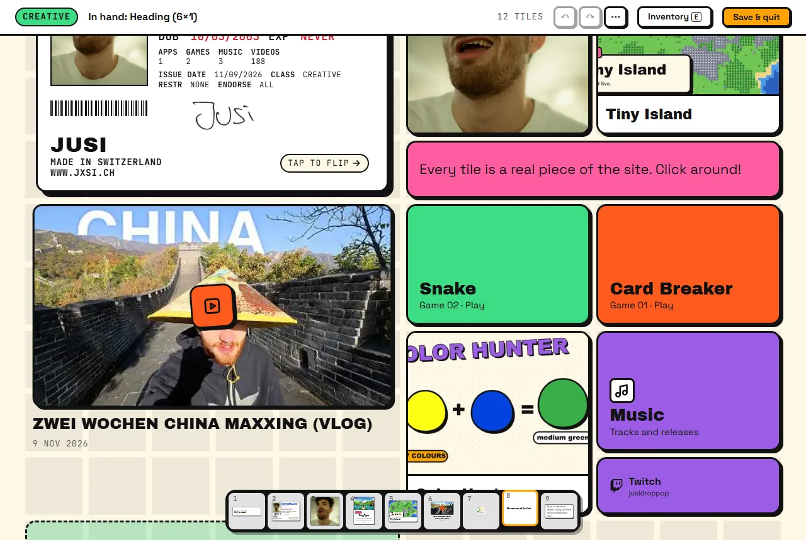
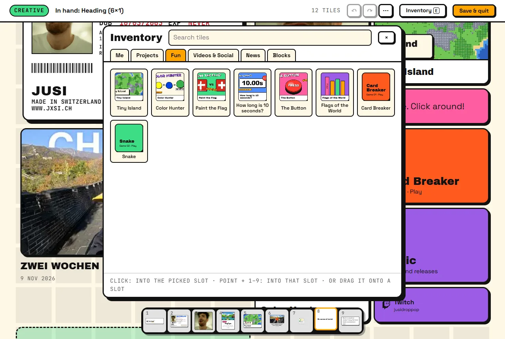

My business card says "Creative License". Now the word *Creative* is a
button: click it and you are in creative mode, where you build your own
start page out of every piece of this site.

## What's new

- **A grid like a building game.** Twelve columns of square cells. Pick a
  tile, click to place it, right-click to take it away, drag it somewhere
  else, press R for another size.
- **Hotbar and inventory.** Nine slots at the bottom (1–9 or the mouse wheel
  over the hotbar), and E opens the inventory with every tile in six tabs and
  a search: the card, my portrait, every project, every game, the latest
  video, social links, updates, and blocks for your own headings, text,
  stickers and colours.
- **Undo, redo, start from the hub.** Ctrl+Z and Ctrl+Y, up to 100 steps.
  One click rebuilds my normal hub page from tiles, so you can start from
  there and move things around.
- **It becomes your start page.** Save and quit, and next time you open
  jxsi.ch you see your own page instead of the card. "Original card" brings
  the card back.
- **Share it.** "Copy share link" puts your whole build into the link
  itself. Nothing is uploaded, and whoever opens the link sees your page
  and can keep it as theirs.
- **Phones and keyboards.** On a phone you tap to place, and tapping a tile
  opens a small menu. With a keyboard you can build without a mouse: tab to
  the grid, move a cursor with the arrows, and every change is read out for
  screen readers.
- **Little extras.** Tiles pop in, removed tiles break into pieces like the
  cards in Card Breaker, and there are tiny sounds (M switches them off).

## What was hard

**Tiles in sizes they were never made for.** The project cards, the video
and the business card were all built for one width. Most tiles now fill
their box and size their text to it. The bigger components keep their own
layout and shrink to fit instead.

**The same look everywhere.** Every tile is rendered once, with the real
components, on a hidden page. The creative mode loads that page and borrows
its stylesheets, so a tile looks exactly like it does on the site. That also
means new projects and updates show up as tiles by themselves.

**Not making the card page heavier.** Almost nobody will ever open creative
mode, so its code and styles only load when you click *Creative*. The build
tool kept putting the editor's styles into the card page anyway, until I
loaded them by hand.

**Sharing without a server.** The build travels compressed in the part of
the link after the `#`, which never reaches my server. A link can come from
anyone, so every build from outside is checked strictly: unknown tiles,
wrong sizes and overlaps are dropped, and your own text is only ever shown
as text.

**Dragging on phones.** On a touch screen dragging has to scroll the page,
so moving a tile by dragging would fight with scrolling. That is why
tapping a tile opens a menu with *Move* in it instead.

## Bugs fixed

- Every click rebuilt the whole grid, so all tiles flickered. Now only the
  tile that changed is touched.
- After a rewrite the "Save & quit" button did nothing (only Esc worked).
- On your own start page the creative mode and the games were invisible,
  because they sat inside the hidden card.
- The inventory stuck out of the screen on phones.
- On small game tiles the text under the picture was cut off.
