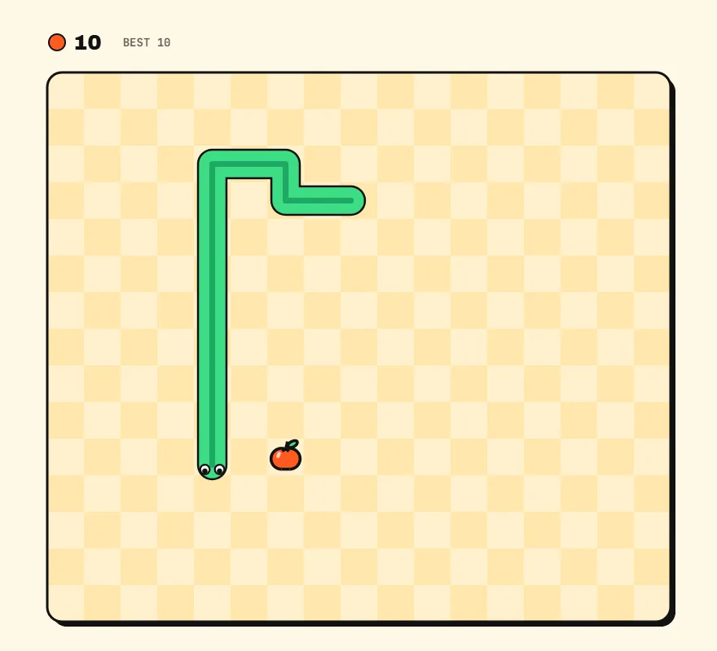

The business card hides a second game now. Click the **S** in JUSI, bottom
left on the front of the card, and the card turns into a Snake board.

## What's new

It is Snake the way everybody knows it, and that was the whole point. No
items, no levels, just you, a snake and an apple.

- A checkered board grows out of the card. The snake waits on the left and the
  apple on the right.
- The first arrow key (or WASD, a swipe, a click or space) starts the run.
  After that it moves at one steady speed.
- Every apple is one point and makes the snake one piece longer. Hitting the
  wall or your own tail ends the run.
- On a phone you swipe to turn. A long swipe can turn twice.
- P pauses, Esc or the × closes it, and your best score stays on your device.
- On tall screens the board turns round, so it fills a phone better.

## What was hard

**Gliding on a grid.** The game itself jumps from cell to cell, but a snake
that jumps looks cheap. So the drawing glides the head into the next cell and
the tail out of the last one, while the rules still only check whole cells.

**Fast turns.** If you press up and then left very quickly, both presses have to
count, or the snake runs into a wall you were sure you had avoided. Turns are
saved up (two ahead) and played one per step. A turn straight back into
yourself is ignored.

**Hiding a button in a name.** The S is a real button, so it works with the
keyboard too, but it has to look exactly like the other letters until you find
it. The card writes the name in capitals with CSS, and buttons don't pick that
up by default, so without one extra line the S would have been a small "s".

## Bugs fixed

- The best score sat right under the close button, so it moved next to the
  score.
- The "press an arrow key" hint covered the snake at the start, so it moved
  further down the board.
