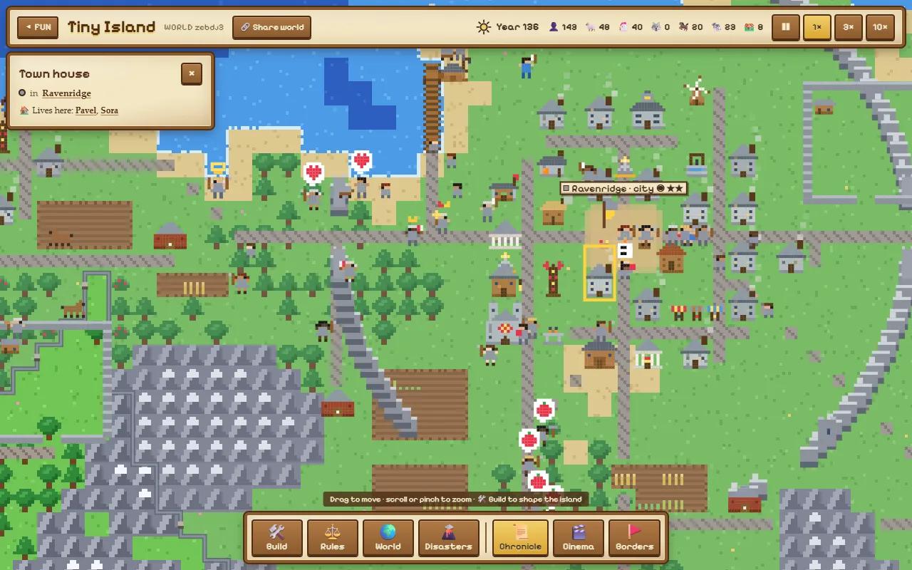
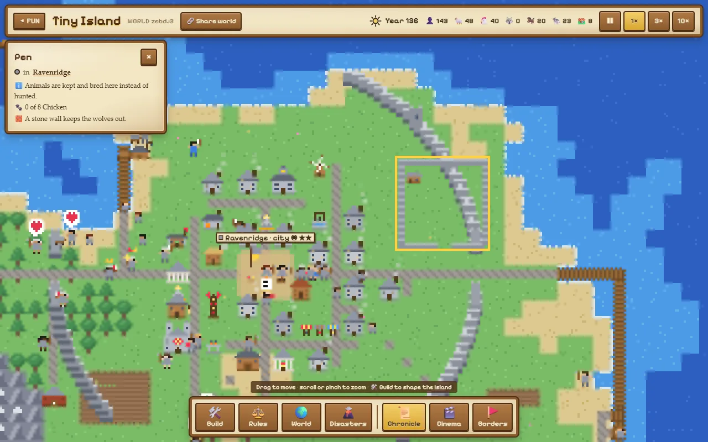

Update 3 is the biggest one yet, and it changed what the island feels like.
It was built in seven phases.

## What's new

- **A new interface.** A bar at the bottom like in sandbox games: Build,
  Rules, World, Disasters, Chronicle, Cinema and Borders, each its own window.
- **Land and borders.** Every place owns the land around it. Kings claim
  more, settlers grab land that is not theirs, and wars are fought over
  territory.
- **Real towns.** Street grids, highways, bridges, railways with trains,
  fenced fields, pens with animals, castles, and walls that change with the
  age.
- **Faiths.** Prophets found religions with their own doctrines. Priests,
  missionaries, pilgrims, schisms, state religions and holy wars follow.
- **Culture.** Philosophers write books, actors stage plays about things that
  really happened on the island, musicians play in taverns, and fools make
  fun of the king.
- **Disasters.** Lightning, spreading fires, volcanoes, hurricanes,
  heatwaves, and a slowly warming world where the sea rises.
- **Cinema mode.** Press K and an invisible director films your island: black
  bars, subtitles, chapter cards and music made in the browser.

## Changed after playing it

The first version of the update had **fog** over everything nobody had
explored. It looked nice and was annoying: it is your world, you want to see
it. The fog is gone.

Then a few smaller wishes:

- **Click on any house or building** to see what it is and who lives there.
  A house shows its family and their children, a pen shows its animals, a
  library its books and a temple its faith and priests.
- **Walls** no longer run up mountains or through the next town.
- **Placing people** no longer asks which people they belong to. They join
  whoever owns the land.

## The cinema got better

The first cinema mode showed everything, and that got boring fast: festival
after festival and lots of quiet streets. Now **time runs ten times as fast** while
nothing big happens, and the camera drifts from place to place. As soon as
something big happens (a war, an eruption, a coronation) it cuts there.

In between, the narrator tells you about the people: who had a child, who
leads a place now, what was just built. *"From now on Linus leads
Mosshold."* *"The people of Redport built a town hall."* *"50 people call
Amberfell home."*

## What was hard

**Testing a world that needs a hundred years.** Every change had to be
checked in a world that was old enough to have cities, kingdoms and wars.
I let worlds run for 150 years in fast forward and then looked at what went
wrong. That is how most of the bugs below were found.

## Bugs fixed

- People were woken from their naps, so nobody ever rested.
- Woodcutters cut down whole forests. There is a limit now.
- One famine led to the next, and new places starved right away. They get a
  grace period now.
- Castles were planned but never built.
- Wars for land never ended, because nobody could win them. Holding the land
  for a while wins now.
- Villages switched faith back and forth every year.
- The chronicle was flooded with philosophers.
- Global warming was far too fast, and lightning far too deadly.
- In cinema mode, declarations of war forgot who the enemy was.
