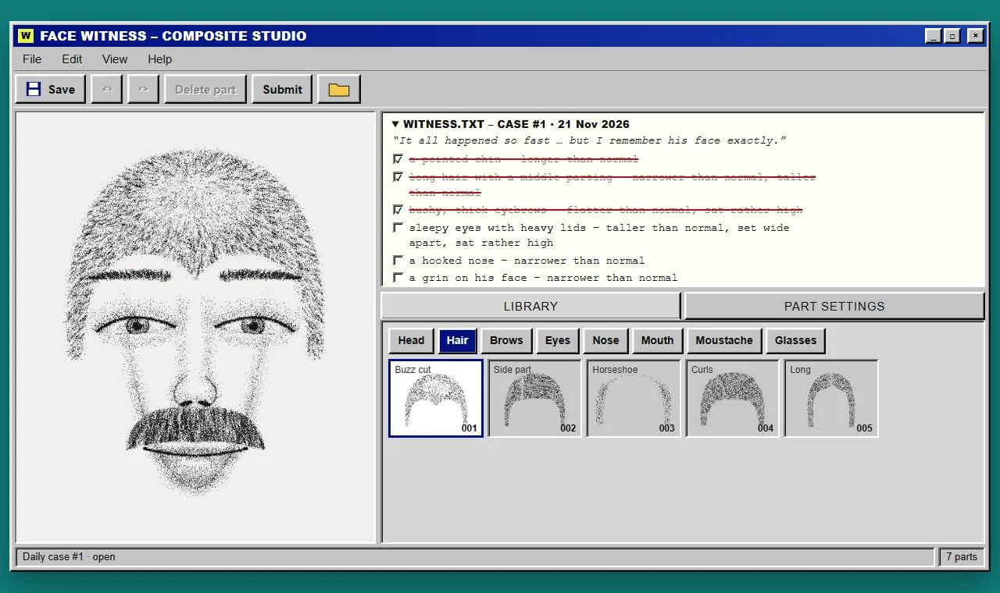
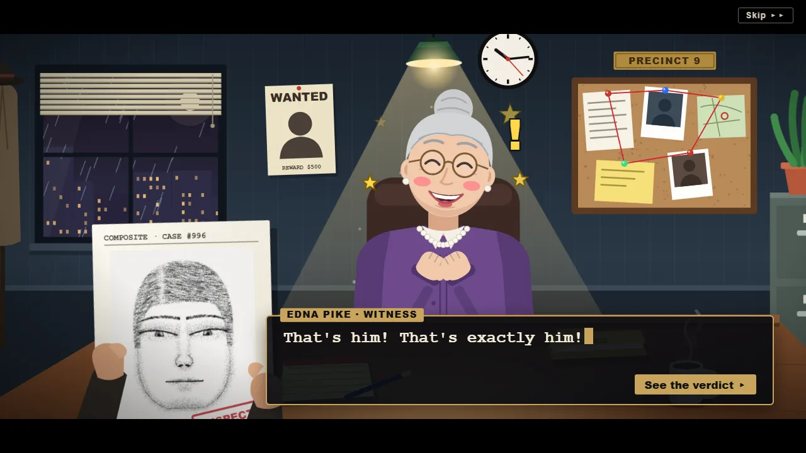
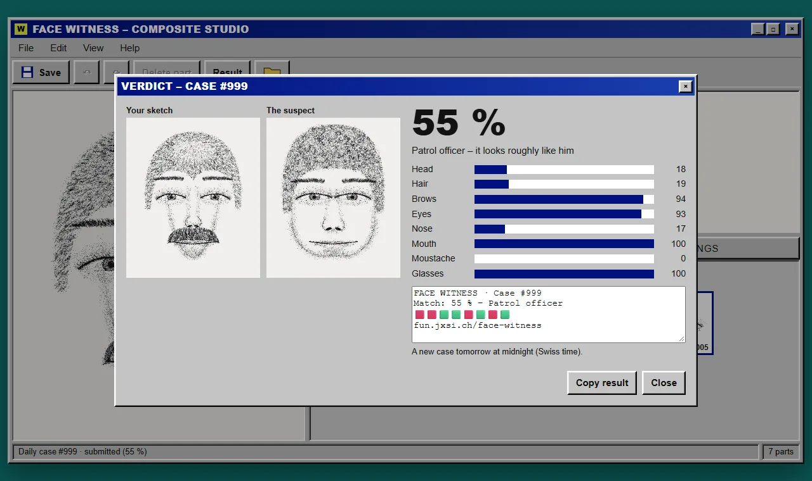

A new daily game on fun.jxsi.ch. A witness saw the suspect, and you build
the police sketch from their statement, in a composite program that looks
like it came with a police computer in 1996.

## What's new

- **A new case every day.** The same suspect for everyone, and the case
  changes at midnight Swiss time like the other daily games.
- **Build the face from parts.** Head, hair, brows, eyes, nose, mouth,
  moustache and glasses, five variants each. Drag them around on the picture,
  and change width, height, rotation and spacing in the part settings.
- **The witness statement** describes every part in words, like "sleepy eyes
  with heavy lids, set wide apart" or "a hooked nose, narrower than normal".
  Tick a line off when you are happy with that part and it gets struck
  through, so you always see what is still left.
- **Submit** and the program prints your sketch. Then you are out of the
  software and in the police station at night: rain on the window, the lamp
  swinging over the desk, coffee steaming. You hold up the sketch and ask the
  witness: "Is this the guy?" They study it, and then they react, from
  clapping with joy over "hmm… maybe?" with a hand on the chin to slamming
  the desk. Every witness says something about your best or your worst part.
- **The verdict** follows: your sketch next to the real suspect, with a score
  per part and a rank from intern to chief inspector. The result can be
  copied as coloured squares to share, and the scene can be watched again.
- **Save** turns your sketch into a "WANTED" poster.
- There is also free drawing, without a case.

## What was hard

**The dotted look.** Every part is drawn as soft shading, crisp lines and
highlights. These get blurred and turned into thousands of tiny random dots,
so the faces look like a printed police sketch instead of clean vector
lines.

**A wide window.** The first version was tall like a phone screen. Now it is
a 16:9 window with the sketch on the left and the statement and library on
the right, and it scales to fit the screen. On a phone held upright that
window would only be about 200 pixels tall, so there the program stacks
everything in one column instead.

**The scene.** It is one drawing of the whole room, and the witness has every
face at once: eyebrows, eyes and mouths are switched and moved, never redrawn.
Only movement and fading are animated, so it stays smooth even on a phone.
There are four witnesses, and the case number decides who sits there that day.

## Bugs fixed

- The sketch first took its size from its own pixels and pushed the window
  far off the screen. Now it takes its size from the window height.
- The verdict did not fit on a laptop screen and cut off its title. Now the
  pictures sit next to the score.
