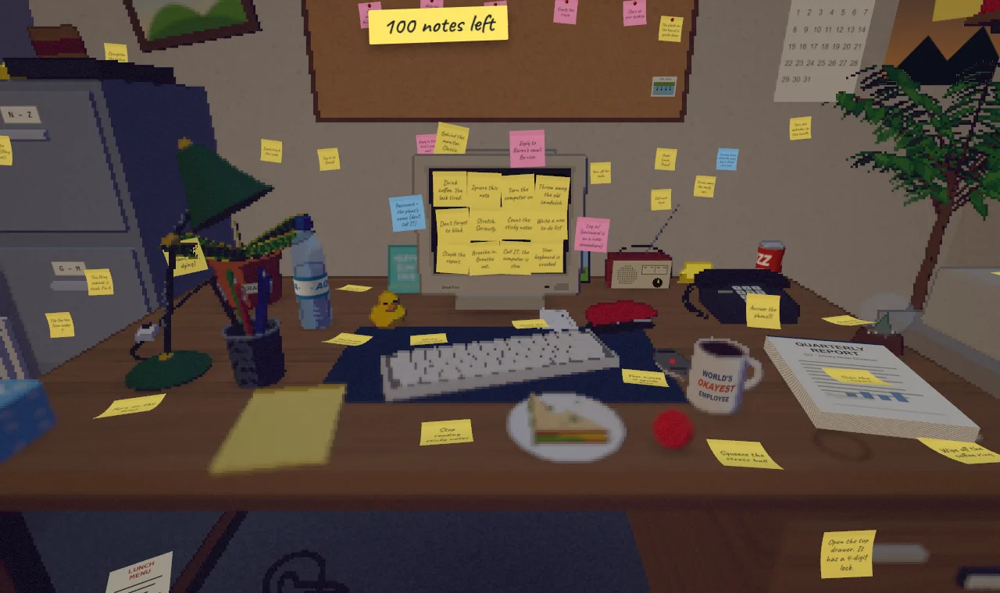
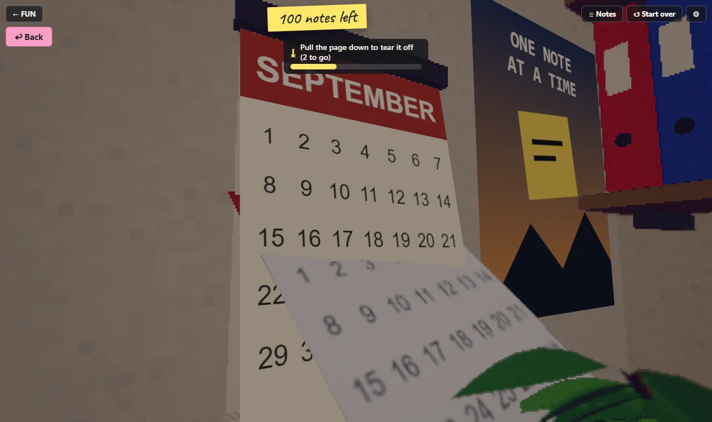
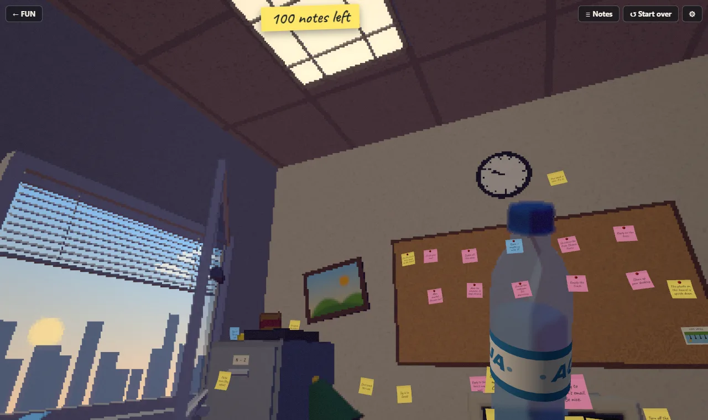
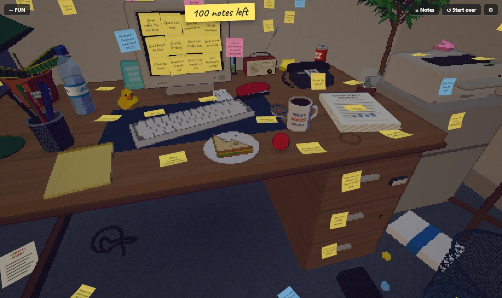
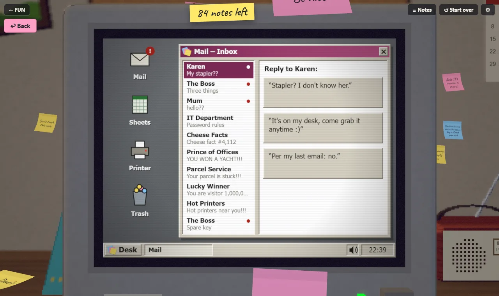
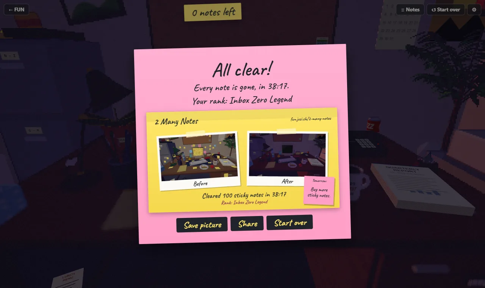

A new game on fun.jxsi.ch, and my first one in 3D. You sit in an office that
is covered in sticky notes, a hundred of them: on the desk, the monitor, the
walls, the door, the filing cabinet, even on your own chair. Every note is a
to-do. Do it, and the note gets torn off, crumpled and thrown into the bin.

## What's new

- **Look around and read.** Move the mouse to the edge of the screen (or
  swipe on a phone) to look around, click a note and it comes up close so you
  can read it. Yellow notes are jobs in the office, pink ones need the
  computer, blue ones are clues for other notes.
- **Every job is a little game.** You don't just click things, you press and
  drag them. Pull the old calendar pages down until they rip off and flutter
  to the floor, turn the crooked picture
  until the bubble of the spirit level sits in the middle, turn the clock's
  minute hand to the right time, tip the water bottle over Gerald the plant
  and stop before he drowns, rub the coffee ring away, shake the snow globe,
  push the window shut and turn its handle, find the one pen that writes and
  scribble a new to-do list, sign the report with your own squiggle, flick
  the old sandwich into the bin (too hard and it lands on the floor). Tap a
  thing with a little game and the camera comes up close, just like a note
  you read. A small sign says what to do and shows how far you are, and when
  the job is done the camera goes back to your chair by itself.
- **The computer is a game in the game.** The monitor runs DeskOS 98, an old
  office system I made up. It is covered in notes too, so you only get to the
  buttons once you have cleared them. Log in (the password is on a note, of
  course), reply to Karen without being rude, delete the spam, fill in the
  coffee budget, book the meeting room, print the report on the real printer.
- **Drawers, locks, hidden notes.** A drawer with a combination lock (the
  digits are on the backs of four notes), a key under Gerald, a filing
  cabinet that only works after a kick, a call-back with a countdown. And
  some notes hide: under the keyboard, behind the picture, in the mug.
- **A room full of little things.** The mug really is a mug (with coffee in
  it and WORLD'S OKAYEST EMPLOYEE on the front), the stapler snaps down when
  you staple, the sandwich has a bite out of it and some mould on top, the
  banana peel lies on the floor with its flaps spread out, and a big ficus
  with hundreds of leaves stands in the corner. When you drink, the mug comes
  up to your face and your head tips back a little, and whatever you throw
  away stays in the bin, on top of the crumpled notes.
- **The day goes by.** Morning light at the start, rain in the afternoon, and
  with the last notes the sun sets over the city outside the window. The radio
  plays elevator music that gets faster the emptier the desk gets.
- **Your progress is saved**, so you can stop and come back later. A full run
  takes about 40 minutes to an hour.
- **At the end** you get a picture to share: the office before and after, your
  time, a job title from Intern to CEO of Sticky Notes, and one last note you
  write yourself, for tomorrow.

## What was hard

**Games you can feel.** Every job has its own little rules: how far you have
to pull, which way you turn, when it counts. Small things like the clock or
the snow globe got a bigger invisible area to grab, so they work with a
finger too. And if you try something three times without getting anywhere,
a tip shows up.

**Close enough to play.** At first the little games happened from your
chair, so the clock or the snow globe were tiny on a phone. Now every game
has its own close-up. Most of them work it out from the size of the thing,
a few have a view of their own: Gerald is watched from the side so the lamp
is not in the way, and the desk drawers from above, so you can see inside.
An open drawer hid the ones below it, so you can now push it shut again.

**Real ink.** The pad, the report and Dave's birthday card are drawn on while
you play, so your scribbles and your signature stay on them.

**A computer inside the 3D room.** DeskOS is drawn on a flat picture that is
put on the monitor's screen. When you click the screen, the game works out
where on that picture you clicked. The notes on the screen sit in front of
it, so they really are in the way until you tear them off.

**Typing on a phone.** The password and the numbers in the spreadsheet need a
keyboard. An invisible text field gets the focus when you tap a field on the
screen, so the phone shows its keyboard.

**The look.** The room is drawn small, a few hundred lines high, and then
blown up with big crisp pixels. The light falls in steps with a touch of
violet in the shadows, edges get thin dark lines, and what you are not
looking at goes soft, like a camera that focuses. I tried three looks
(pixels, watercolour and a toy diorama) and kept the pixels. The sticky
notes, the computer screen and every printed word are drawn a second time
at full sharpness on top, so you can always read them. If you miss the old
look, it is still in the settings as "Classic", next to the wobbly PS1
switch.

**Everything from code.** There are no 3D models from elsewhere: every
thing is built from shapes in the code. The mug and the bottle are turned
like on a lathe, the stapler and the phone are side views pushed into 3D,
the banana peel is made of bent strips, and the ficus has a braided trunk
and over 600 leaves drawn in one go. A small checker looks for things that
stick into each other (a cable through the desk, a window sill inside the
filing cabinet, a paper ball inside the paper), and it now finds none.

**A hundred notes without getting lost.** The Notes button (or Tab) lists
every note in sight and pauses the game, and "Show me" turns you towards one.
If you read a note and don't get anywhere for 20 seconds, the thing it needs
starts to glow softly.

## Bugs fixed

- The open window swung outwards, behind the wall, so you could not see it.
  It opens into the room now.
- The bin stood right in front of the desk drawers, so the bottom drawer
  slid into it. It moved a bit to the right.
- Open drawers hid each other's insides. Now opening one closes the others.
- A message about updates sat right on top of the reply button in the mail
  app. It now only shows when no window is open.
- "Start over" saved the old desk again while the page was reloading, so
  nothing was reset. Now saving is switched off first.
- The "after" picture at sunset was almost black. The evening light is a bit
  brighter now.
- A few things stuck into each other: the lamp's cable ran straight through
  the desk, the keyboard lay on the notepad, the skirting board went across
  the door. They all have their own place now.
